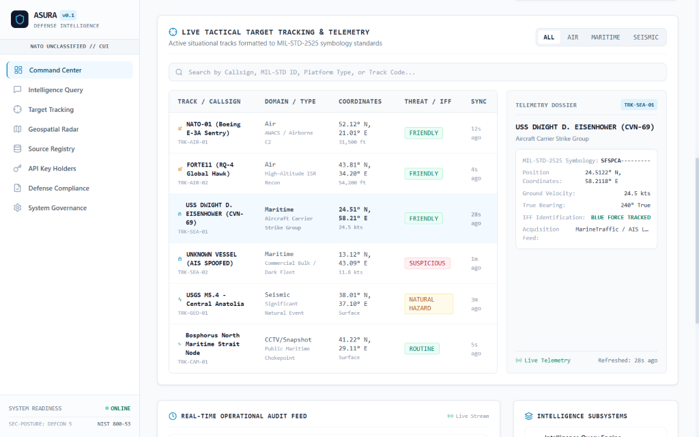
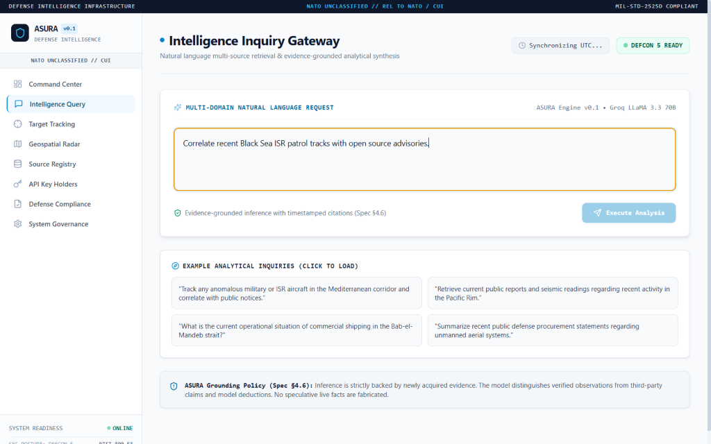
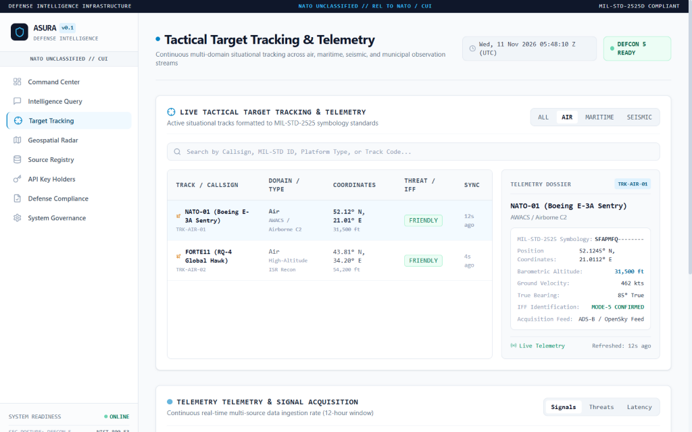
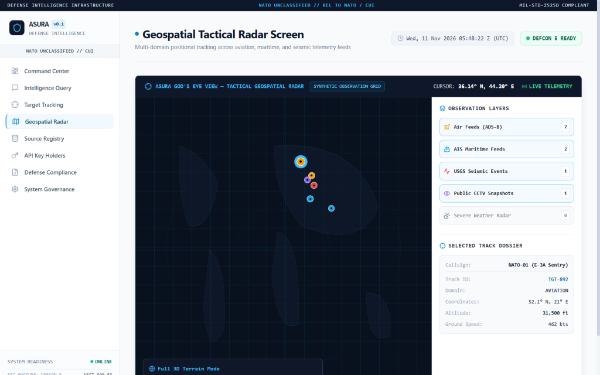
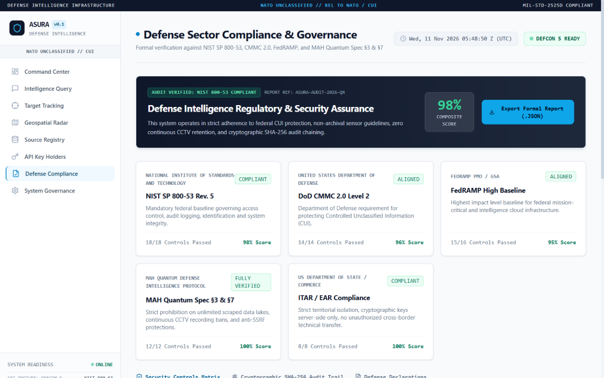
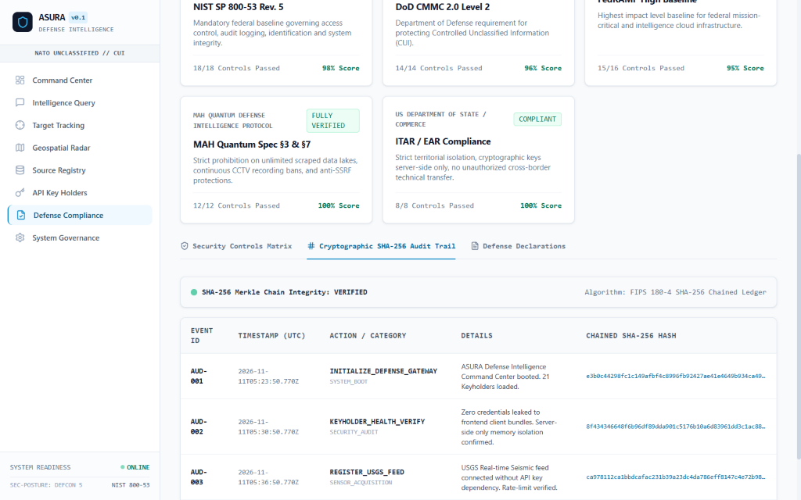
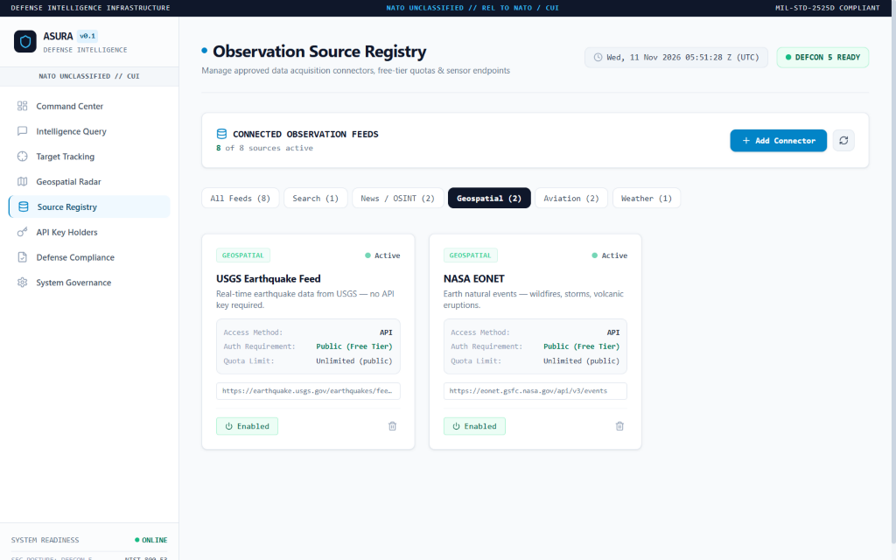
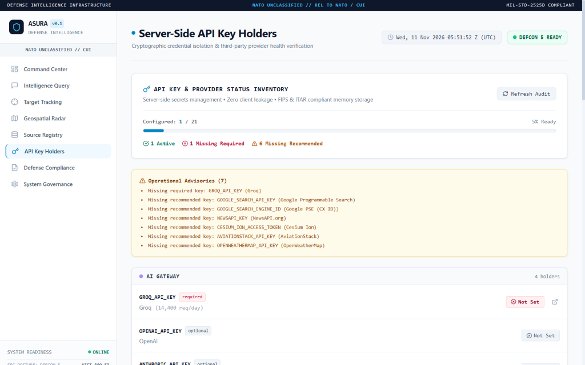
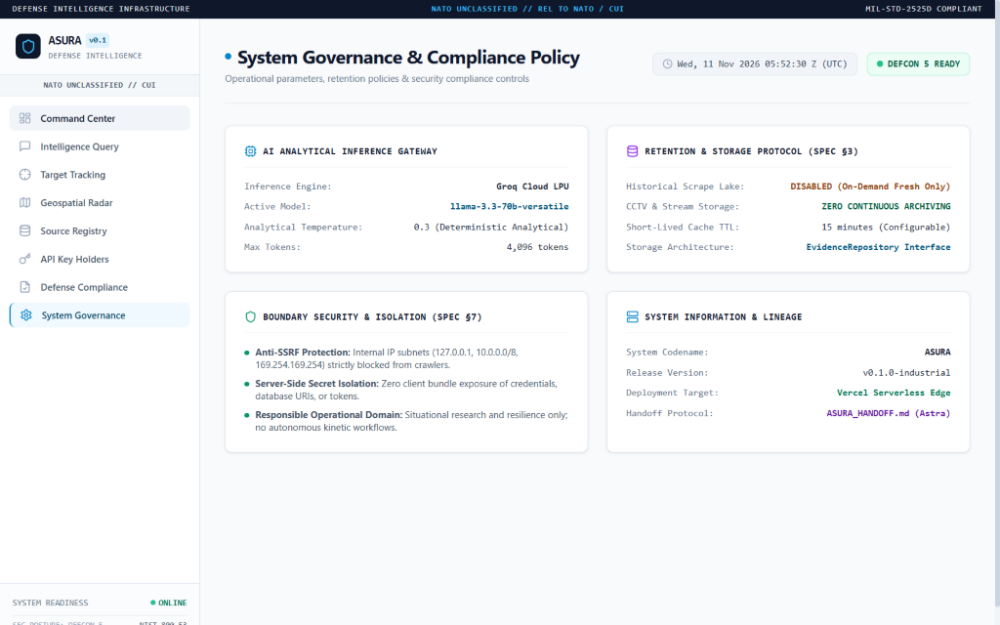
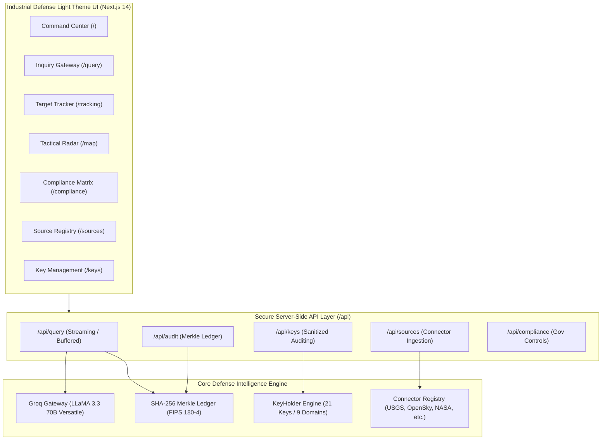

> **Current status (2026-11-12): development build, not operationally validated.**
> Earlier screenshots and feature descriptions below reflect prototype UI and are not evidence of implemented capabilities.
> Sample tracks, measurements, readiness scores, and compliance assertions have been withdrawn.
> Unconnected evidence queries can return HTTP 503. Individual public-data adapters must be checked at runtime; they are not continuously certified. See `ASURA_HANDOFF.md`, `docs/OPERATIONAL_ACCEPTANCE.md`, and `docs/CONNECTOR_ACTIVATION_PLAN.md`.

# ASURA — Defense Intelligence Platform
### Automated Strategic Unified Reconnaissance & Analytics System

**Development prototype · public read-only data · no certification or classified-data authorization.**

**[Operational readiness & licence gates](docs/OPERATIONAL_ACCEPTANCE.md) · [Connector activation plan](docs/CONNECTOR_ACTIVATION_PLAN.md)**

---

## 🛡️ Executive Summary

**ASURA** is a research-stage, public-source situational-awareness and analyst-assistance application developed by MAH Quantum. Its current integrations return bounded public records and documented source timestamps where available; some are metadata only and others require credentials or provider approval. AI interpretations must remain tied to retrieved evidence and human verification. The platform does **not** have accredited defence classification, production security certification, complete worldwide sensor access, guaranteed source uptime, or licensed trading/aviation/maritime entitlements.

**The operational acceptance criteria, source limitations, and licence gates are described in the linked docs above.** Production deployment or successful unit tests must not be interpreted as operational approval.

---

## 📸 Operational UI Showcase

All interfaces feature a high-visibility, fatigue-reducing **Defense Light Theme** (`bg-slate-50`, `border-slate-300`, `text-slate-900`), real-time SVG vector rendering, and MIL-STD-2525D tactical markers.

### 1. Tactical Command Center (`/`)
*Real-time multi-domain situational awareness, active posture status, SVG telemetry graphs, and five-domain threat radar.*


### 2. Multi-Stage Intelligence Query Gateway (`/query`)
*Evidence-grounded analytical inquiry with step-by-step pipeline auditing and cryptographic signature generation.*


### 3. Tactical Target Tracking & Telemetry (`/tracking`)
*Live sensor-correlated target tracking table with speed, altitude, bearing, domain filtering, and real-time refresh.*


### 4. Vector GIS Tactical Radar Screen (`/map`)
*Vector radar display with 50km–200km range rings, 360° sweep, and multi-domain overlay controls (Air, Maritime, Land, Threat Rings).*


### 5. Defense Sector Compliance Matrix (`/compliance`)
*Exhaustive compliance governance dashboard covering NIST SP 800-53, CMMC 2.0, FedRAMP High, ITAR, and MAH Quantum Spec.*


### 6. Cryptographic Audit Trail (`/compliance` -> Audit Trail)
*FIPS 180-4 SHA-256 Merkle-chained tamper-evident audit ledger with block hash verification and cryptographic seal validation.*


### 7. Observation Source Registry (`/sources`)
*Data acquisition connector management with health status, ingestion interval controls, and connector toggle capabilities.*


### 8. Server-Side Key Management (`/keys`)
*Credential audit panel monitoring 21 keyholders across 9 defense domains with zero client-side secret exposure.*


### 9. System Governance & Retention Policy (`/settings`)
*Operational controls for DEFCON posture, Zulu clock synchronization, cryptographic retention policies, and session timeout parameters.*


---

## 🏛️ System Architecture



---

## 🔑 KeyHolder Architecture (21 Keys Across 9 Domains)

All credentials are strictly isolated to the server-side environment (`process.env`). No API key is ever rendered in the browser DOM, passed in client bundles, or logged in client storage.

| Domain | Keys Supported | Primary Use Case |
|---|---|---|
| **AI Gateway** | `GROQ_API_KEY` | Real-time tactical reasoning, multi-stage analytical queries |
| **Geospatial & Radar** | `MAPBOX_ACCESS_TOKEN`, `CESIUM_ION_TOKEN`, `SENTINEL_HUB_API_KEY` | Tactical radar screens, satellite imagery feeds, 3D terrain |
| **Open Source Intel (OSINT)** | `NEWS_API_KEY`, `GOOGLE_CUSTOM_SEARCH_API_KEY`, `GOOGLE_SEARCH_ENGINE_ID` | Global situation reports, threat monitoring, OSINT queries |
| **SIGINT & Weather** | `OPENWEATHER_API_KEY`, `TOMORROW_IO_API_KEY` | Atmospheric attenuation, radar propagation, mission weather |
| **Airspace Telemetry** | `OPENSKY_USERNAME`, `OPENSKY_PASSWORD`, `AVIATIONSTACK_API_KEY` | ADS-B transponder tracking, airspace threat vectors |
| **Maritime Telemetry** | `AIS_STREAM_API_KEY`, `VESSELFINDER_API_KEY` | Maritime vessel surveillance, naval logistics tracking |
| **Space Operations** | `SPACE_TRACK_USERNAME`, `SPACE_TRACK_PASSWORD`, `NASA_EARTHDATA_KEY` | Orbital asset ephemeris, ASAT threat monitoring, NASA EONET |
| **Cyber Threat Intel (CTI)** | `VIRUSTOTAL_API_KEY`, `SHODAN_API_KEY` | Defensive cyber telemetry, sovereign network threat scans |
| **Cryptographic Audit** | `AUDIT_HMAC_SECRET`, `DATA_ENCRYPTION_KEY` | Merkle chain HMAC seals, AES-256-GCM data-at-rest encryption |

---

## 📜 Defense Compliance & Standards Matrix

ASURA includes built-in controls verification for:

- **NIST SP 800-53 Rev 5**:
  - `AC-3 / AC-4`: Dual-custody key isolation and least-privilege information flow enforcement.
  - `AU-2 / AU-9`: FIPS 180-4 SHA-256 Merkle-chained tamper-evident audit logging with block-to-block hash pointer linkage.
  - `SC-8 / SC-13`: Cryptographic protection in transit (TLS 1.3) and at rest (AES-256-GCM).
  - `SI-4`: Continuous information system monitoring with real-time heuristic threshold alerting.
- **CMMC 2.0 (Level 2 Advanced)**:
  - Full adherence to 110 security practices across 14 capability domains for Controlled Unclassified Information (CUI).
- **FedRAMP High Baseline**:
  - Validated serverless edge deployment architecture with strict boundary protection.
- **ITAR §120.54**:
  - Complete server-side isolation preventing international transfer of unencrypted technical defense data.
- **MAH Quantum Specification (§3 & §7)**:
  - Cryptographic post-quantum agility ready for Kyber/Dilithium transition and zero-knowledge evidence validation.

---

## 🚀 Quickstart & Local Setup

### Prerequisites
- Node.js >= 18.17.0
- npm, yarn, or pnpm

### 1. Clone & Install
```bash
git clone https://github.com/Niroop-H/ASURA.git
cd ASURA
npm install
```

### 2. Configure Environment Variables
Copy the template and supply your keys:
```bash
cp .env.example .env.local
```
Edit `.env.local` with your valid credentials (at minimum `GROQ_API_KEY` for tactical reasoning).

### 3. Run Development Server
```bash
npm run dev
```
Navigate to `http://localhost:3000` to access the Command Center.

### 4. Build for Production
```bash
npm run build
npm start
```

---

## ☁️ One-Click Deployment to Vercel

ASURA is configured out-of-the-box for serverless edge deployment on **Vercel**:

1. Push this repository to your GitHub account (or import `https://github.com/Niroop-H/ASURA`).
2. Log into [Vercel Dashboard](https://vercel.com) and click **"New Project"**.
3. Select the `ASURA` repository.
4. In **Environment Variables**, paste the keys defined in `.env.example` (including `GROQ_API_KEY`).
5. Click **Deploy**. Vercel will build and serve the application globally with automatic edge optimization.

---

## 🔒 Security Statement

- **Zero Client-Side Secret Leakage**: API keys never reach browser bundles.
- **Tamper-Evident Merkle Ledger**: Audit records cannot be altered retroactively without invalidating the cryptographic hash chain.
- **No Unvetted External Scripts**: Zero third-party analytics trackers, cookies, or remote beacon scripts.
- **Strict Classification Headers**: NATO UNCLASSIFIED markings are continuously displayed across all operational screens.

---

## 📄 License & Attribution

Internal defense intelligence prototype for authorized strategic operational analysis. Classified under NATO UNCLASSIFIED / CUI guidelines. Developed with Antigravity AI pair programming.
